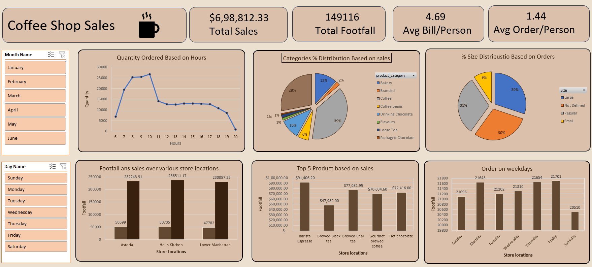

# ☕ Coffee Shop Sales Analysis Dashboard

## 📌 Project Overview

This project presents an interactive Coffee Shop Sales Dashboard built entirely using Microsoft Excel. It analyzes sales performance, customer footfall, product categories, order sizes, store locations, and ordering trends to support data-driven business decisions.

## 📊 Dashboard Preview



## 🎯 Project Objectives

- Analyze total sales and customer footfall.
- Identify peak ordering hours.
- Understand sales contribution by product category.
- Analyze order size distribution.
- Compare sales and footfall across store locations.
- Identify the top 5 products by sales.
- Analyze orders across weekdays.
- Explore results using interactive slicers.

## 🛠️ Tools Used

- Microsoft Excel
- Data Cleaning
- PivotTables
- PivotCharts
- Excel Formulas
- Interactive Slicers
- Data Visualization

## 📈 Key Performance Indicators (KPIs)

| KPI | Value |
|---|---:|
| Total Sales | $698,812.33 |
| Total Footfall | 149,116 |
| Average Bill per Person | 4.69 |
| Average Orders per Person | 1.44 |

*Values are based on the dashboard screenshot and should be validated against the source dataset.*

## 📉 Dashboard Features

### 1. Quantity Ordered by Hour
Analyzes order quantities across different hours to identify busy periods.

### 2. Sales by Product Category
Shows the contribution of different product categories to total sales.

### 3. Order Size Distribution
Compares Large, Regular, Small, and Not Defined order sizes.

### 4. Store Location Analysis
Compares sales and customer footfall across store locations.

### 5. Top 5 Products by Sales
Highlights the products generating the highest sales.

### 6. Orders by Weekday
Displays order patterns across different days of the week.

### 7. Interactive Slicers
Month Name and Day Name slicers allow users to filter dashboard results.

## 🔄 Project Workflow

1. Import the sales dataset into Excel.
2. Clean and prepare the data.
3. Create PivotTables for analysis.
4. Build PivotCharts and KPI cards.
5. Add interactive slicers.
6. Format the dashboard.
7. Validate the results and review business trends.

## 💡 Business Value

- Helps identify busy business hours.
- Supports product sales comparisons.
- Enables store performance analysis.
- Provides a clear overview of sales and customer activity.
- Helps management explore sales trends interactively.

## 📁 Project Structure

```text
Coffee-Shop-Sales-Analysis/
├── data/
│   └── coffee_shop_sales.xlsx
├── images/
│   └── dashboard.png
├── Coffee_Shop_Sales_Dashboard.xlsx
└── README.md
```

*Adjust the filenames and folders to match your actual repository.*

## 🚀 How to Use

1. Download or clone this repository.
2. Open `Coffee_Shop_Sales_Dashboard.xlsx` in Microsoft Excel.
3. Use the Month Name and Day Name slicers to filter the data.
4. Explore the KPI cards, charts, and sales trends.

## 👨‍💻 Author

**Manik Chand**  
B.Tech — Computer Science & Engineering (Artificial Intelligence)

---

⭐ If you find this project useful, consider starring the repository.
